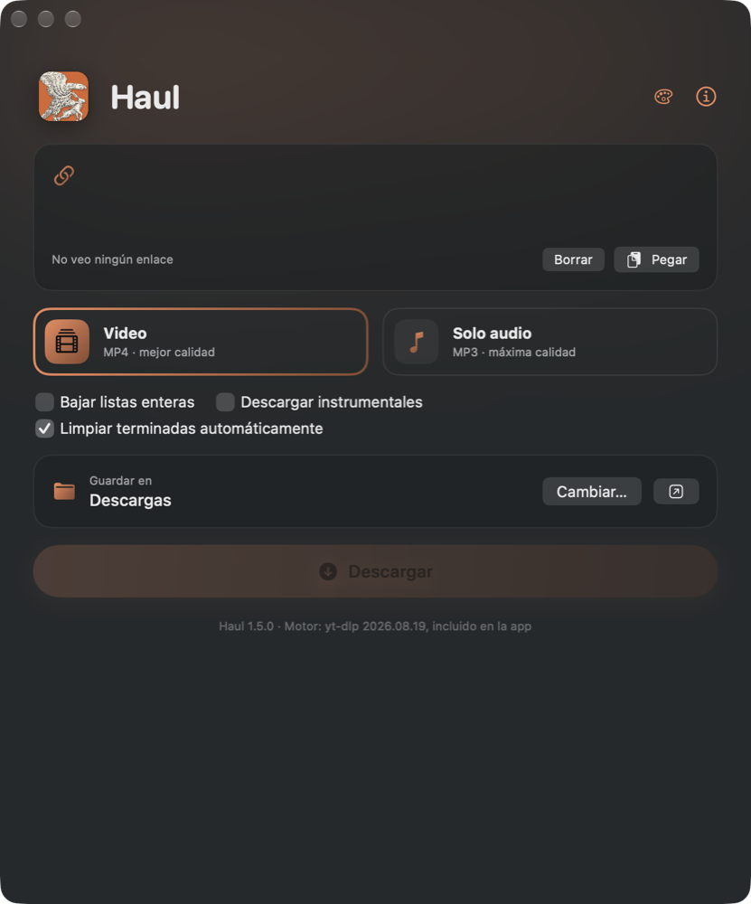
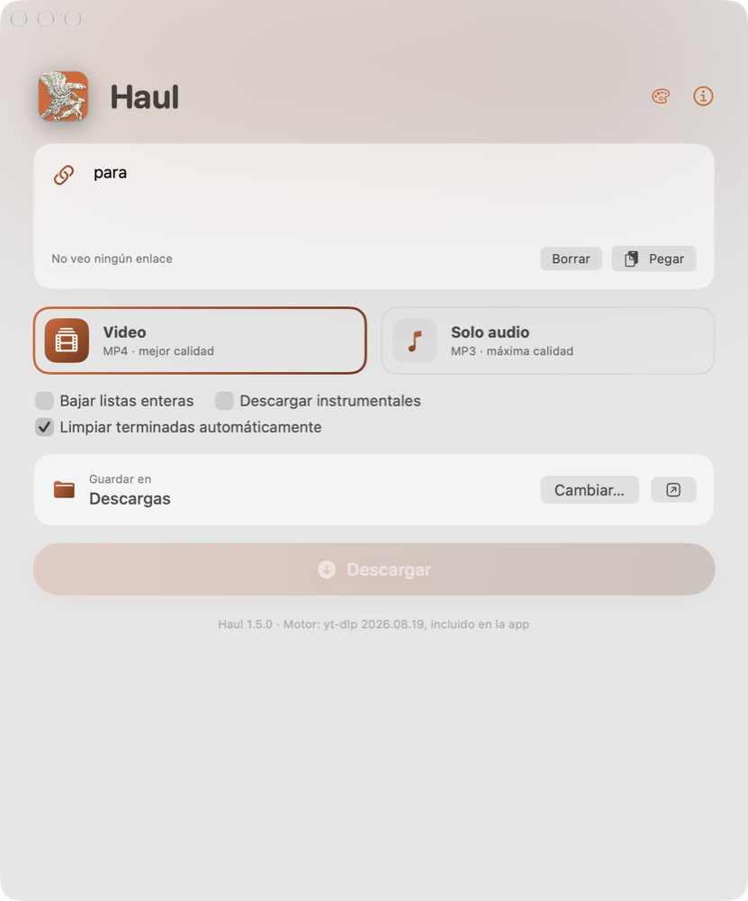

<p align="center"></p>

<h1 align="center">Haul</h1>
<p align="center"><b>Videos y música de la web a tu carpeta, con yt-dlp haciendo el trabajo.</b></p>

<p align="center"></p>

Gabriel Castiglia · 11 de noviembre de 2026 · versión 1.5.1 · GPL-2.0-only · hecho y probado con yt-dlp 2026.08.19

[English](README.md) · Español

Versión para Windows: <https://github.com/Gabriel-Castiglia/haul-windows>

> **Solo para macOS 15 o posterior en Apple silicon (arm64).** No hay versión para Mac con procesador Intel.

Manual en PDF: [`docs/Haul-manual-es.pdf`](docs/Haul-manual-es.pdf)

Haul es una aplicación de macOS que hace de interfaz de
[yt-dlp](https://github.com/yt-dlp/yt-dlp). La aplicación arma el comando, muestra
el progreso y organiza una cola de descargas. El trabajo lo hacen yt-dlp, incluido en la aplicación
en una versión fija y verificada, y ffmpeg, instalado con Homebrew. La interfaz está en inglés y en castellano, y se elige en el menú Language (Idioma cuando
la app está en castellano). La primera vez arranca en inglés y después recuerda la elección. La
ventana puede ser clara, oscura o seguir a macOS, en uno de doce colores.

## Requisitos

- macOS 15 o posterior, en una Mac con chip Apple. Se probó en macOS 27.
- [Homebrew](https://brew.sh) en `/opt/homebrew`.
- Para compilar desde el código: Command Line Tools de Apple (`xcode-select --install`). No se
  necesita Xcode.

yt-dlp viene dentro de la aplicación, y Python, deno y ffmpeg los instala el instalador, así que no
hay que instalar nada a mano.

## Instalación

### Con el paquete de instalación

Descarga `Haul-<versión>.pkg` de la
[última versión publicada](https://github.com/Gabriel-Castiglia/haul/releases/latest) y ábrelo. El instalador está
en inglés o en castellano, según el idioma de la Mac. Comprueba que Homebrew esté instalado y, si no
lo está, se detiene con un aviso; después instala `Haul.app` en `/Applications`, cerrando antes una
copia abierta, e instala Python, deno y ffmpeg con Homebrew, o los actualiza si ya están. La primera
vez ese paso puede tardar unos minutos. Instalar un paquete más nuevo actualiza Haul y conserva sus
ajustes.

El paquete no está firmado con un Developer ID de Apple, así que la primera vez macOS se niega a
abrirlo («Apple no pudo verificar…»). Abre Ajustes del Sistema → Privacidad y seguridad, baja hasta el
aviso sobre `Haul-<versión>.pkg`, haz clic en Abrir igualmente y confirma. La app instalada abre sin
avisos. El archivo `SHA256SUMS.txt` de cada versión permite comprobar antes la descarga:

```
shasum -a 256 Haul-1.5.1.pkg
```

Para desinstalar, cierra Haul y arrastra `/Applications/Haul.app` a la Papelera. Python, deno y ffmpeg
quedan, porque otros programas pueden usarlos; `brew uninstall` los borra.

### Desde el código

```
git clone https://github.com/Gabriel-Castiglia/haul.git
cd haul
scripts/instalar.sh
```

El instalador:

1. instala Python, deno y ffmpeg con Homebrew o, si ya están, los actualiza;
2. compila la aplicación, comprueba el yt-dlp incluido contra sus sumas oficiales y firma la
   aplicación con la identidad local (ver «Firma y permisos»);
3. la copia a `/Applications/Haul.app`, cerrándola antes si estaba abierta.

Volver a ejecutarlo es la forma de actualizar todo: dependencias y aplicación. `scripts/paquete.sh`
arma en cambio el paquete de instalación, en `build/`. Una copia instalada con el paquete pertenece a
root, así que `scripts/instalar.sh` se detiene y dice cómo quitarla antes.

## Uso

1. Pegar uno o varios enlaces en el recuadro superior. Se aceptan enlaces sueltos, uno por línea o
   dentro de un texto copiado de otra parte; la aplicación los extrae y descarta los duplicados. Si
   el acceso al portapapeles está permitido, al abrirla incorpora sola el enlace copiado.
2. Elegir el formato, Video (MP4) o Solo audio (MP3).
3. Elegir la carpeta de destino. La primera vez es Descargas; después se conserva la última
   elegida, igual que el formato.
4. Pulsar Descargar o ⌘↩. El recuadro se vacía al empezar la descarga, y un enlace que ya
   está en la cola no vuelve a entrar solo desde el portapapeles.

Los enlaces entran en una cola y se descargan de a uno. Mientras la cola avanza se pueden agregar
más enlaces. Cada fila muestra la miniatura, el título, el porcentaje, la velocidad y el tiempo
restante, y al terminar ofrece mostrar el archivo en el Finder o abrirlo. Las descargas con error o
canceladas se pueden reintentar o quitar. Una descarga cancelada borra los archivos a medias que había
creado; los que ya estaban en la carpeta, como una descarga anterior del mismo video en otro formato,
no se tocan nunca.

Cada fila se puede pausar con su botón de pausa y seguir con el de reproducir; mientras tanto, los
archivos a medias quedan en el disco y la descarga retoma donde quedó. «Pausar todo», arriba de la
cola, frena la cola entera: la descarga en curso se detiene y espera primera en la fila hasta «Seguir
todo». «Reintentar todas» aparece cuando alguna descarga falló y vuelve a lanzar todas las fallidas.
Las filas se arrastran con el mouse para cambiar el orden, y las descargas arrancan en el orden de la
lista.

Una descarga que falla se reintenta hasta cuatro veces, con dos segundos entre cada intento, y la fila
muestra qué intento está en curso («Reintento 2/4»). Los archivos a medias se conservan entre intentos,
así yt-dlp sigue desde donde quedó. Cuando una descarga termina, la aplicación borra además los
archivos intermedios que yt-dlp no pudo quitar, como el audio original de un MP3 mientras un cliente
de sincronización de archivos lo tenía abierto.

La casilla «Limpiar terminadas automáticamente», debajo del formato, está siempre a la vista, aunque
la cola esté vacía. Mientras está marcada, cada descarga que termina o se cancela
sale sola de la lista y el resumen la sigue contando; las que fallaron quedan, para poder reintentarlas.
Al marcarla también se limpia lo que ya había terminado. La aplicación recuerda la elección.

Los videos con «instrumental» en el título esperan en la cola, en pausa, salvo que esté marcada
«Descargar instrumentales». Una fila en pausa se puede bajar sola con su botón de descarga, y al
marcar la opción se reanudan todas.

El botón ⓘ de la ventana, o Haul > Acerca de Haul en la barra de menús, muestra la versión, qué
significa el nombre, el autor, la licencia y el enlace a este repositorio, en el idioma de la interfaz.
Desde el encabezado hasta el botón Descargar todo queda fijo; solo la cola se desplaza, así que
agregar enlaces nunca mueve la ventana.

También se puede iniciar con enlaces desde la Terminal o desde Atajos:

```
open -a Haul --args --descargar URL1 URL2
```

## Formatos

| Formato | Resultado | Opciones de yt-dlp |
|---|---|---|
| Video | MP4 con H.264 y AAC, a la mayor resolución disponible en H.264 | `-f bv*+ba/b -S vcodec:h264,res,acodec:aac --merge-output-format mp4` |
| Solo audio | MP3 a la máxima calidad | `-x --audio-format mp3 --audio-quality 0` |

Se prefiere H.264 porque QuickTime y iOS lo reproducen sin conversión. Los archivos llevan el título del video como nombre.

## Listas de reproducción

Un enlace a una lista o a la página de un canal se lee primero, sin descargar nada, y cada video pasa a ser una fila propia de
la cola, con su miniatura y su posición («Mix · 3/12»). Los archivos van a una subcarpeta con el nombre
de la lista y se numeran en el orden de la lista: `01 - Título.mp4`, `02 - Título.mp4`, etcétera. Cada
video se puede cancelar o reintentar por separado. Una lista de más de 200 videos pide confirmación
antes de entrar a la cola.

Un enlace a un video abierto desde una lista trae la lista entera mientras esté marcada «Bajar
listas enteras», que viene marcada. Con la opción desmarcada, una tarjeta en la ventana pregunta cada
vez si se baja solo ese video o la lista entera. La app recuerda el ajuste. Los demás enlaces se
descargan tal cual, un video cada uno.

Algunas páginas de etiqueta que agrupan varias publicaciones, cada una con un video embebido, se leen
igual: una fila por publicación, de la más vieja a la más nueva, así una serie conserva el orden de
sus episodios.

## Estructura del repositorio

| Ruta | Contenido |
|---|---|
| `fuentes/Haul.swift` | Código de la aplicación (SwiftUI, un solo archivo) |
| `assets/` | El grabado del que sale el ícono |
| `scripts/make_icon.py` | Dibuja el ícono en sus doce colores (Python 3 con numpy, opencv-python, scipy y Pillow); el mismo script hace el ícono de la versión para Windows |
| `icono/icono-1024.png` | El ícono de la app, en su naranja de siempre, origen de todos los tamaños |
| `icono/accents/` | El ícono en cada color, para el Dock |
| `docs/images/` | Imágenes de la ventana |
| `scripts/instalar.sh` | Dependencias, compilación e instalación |
| `scripts/paquete.sh` | Arma el paquete de instalación `build/Haul-<versión>.pkg` |
| `instalador/` | Definición del paquete: `Distribution.xml`, los scripts que cierran Haul e instalan los paquetes de Homebrew, y las páginas en inglés y en castellano |
| `scripts/compilar.sh` | Compilación y firma en `build/` |
| `scripts/firma.sh` | Identidad de firma local (la carga `compilar.sh`) |
| `scripts/manual.sh` | Genera los manuales en PDF a partir de los README |
| `scripts/actualizar-yt-dlp.sh` | Reemplaza el yt-dlp incluido por otra versión verificada |
| `plugins/haul/` | Complemento de extractores propio de Haul para yt-dlp, para enlaces que la versión incluida no maneja |
| `vendor/yt-dlp/` | Copia incluida de yt-dlp 2026.08.19, con código fuente, sumas, firma y licencias |
| `docs/Haul-manual-es.pdf`, `docs/Haul-manual-en.pdf` | Manuales en PDF, en castellano y en inglés |
| `docs/manual.css` | Estilo de los manuales |
| `README.es.md`, `README.md` | Esta documentación, en castellano y en inglés |
| `CHANGELOG.md` | Historial de versiones |

La carpeta `build/` se genera al compilar y no forma parte del repositorio.

## Firma y permisos

macOS guarda los permisos que el usuario concede, como el acceso a Descargas o al portapapeles,
asociados a la firma de la aplicación. Una firma ad hoc cambia en cada compilación y macOS vuelve a
pedirlos. Por eso el proyecto firma con un certificado propio y estable, «Haul (local
signing)», que `scripts/firma.sh` crea la primera vez en la Mac donde se compila:

- el certificado y su clave quedan en un llavero dedicado,
  `~/Library/Keychains/haul-signing.keychain-db`;
- la contraseña de ese llavero queda en el llavero de inicio de sesión, con el nombre
  `haul-local-signing`.

Con esa firma, los permisos concedidos una vez se mantienen entre versiones. El certificado solo
existe en la Mac donde se creó. La app que va dentro del paquete de instalación lleva la firma de la
Mac que armó la versión, la misma en todas, así que los permisos también se mantienen al actualizar
con paquetes.

El pegado automático de enlaces al abrir la aplicación funciona solo si el acceso al portapapeles
está en «Permitir siempre» (Ajustes del Sistema, Privacidad y seguridad, Pegar desde otras apps).
Sin ese permiso, la aplicación lee el portapapeles únicamente al pulsar Pegar y no muestra avisos
al abrirse.

## Apariencia e ícono

El menú Apariencia, que también está detrás del botón de la paleta de la ventana, elige claro, oscuro o
como macOS, y uno de doce colores. El color elegido pinta los botones, las casillas y lo seleccionado, y
el ícono del Dock mientras Haul está abierto: el águila vuela sobre un fondo de ese color. El ícono del
Finder y de Launchpad sigue naranja, porque cambiarlo rompería la firma de la app. Un Haul que ya se
usó conserva la ventana oscura que tenía; una instalación nueva sigue a macOS.



El ícono es el águila que trae una liebre del grabado «Águila que le trae una liebre a una joven», del
Monogramista B (Italia, siglo XVII), Rijksmuseum, dominio público (CC0). `scripts/make_icon.py` la recorta
del escaneo de `assets/` y la dibuja sobre cada color; necesita Python con numpy, opencv-python, scipy y
Pillow. Después de volver a dibujarlo, `scripts/instalar.sh` reinstala la app. Si el Dock conserva el
ícono anterior, se cierra Haul y se vacía la caché de íconos del Dock:
`rm "$(getconf DARWIN_USER_CACHE_DIR)com.apple.dock.iconcache"; killall Dock`.

## Versiones nuevas

Una vez por día, Haul le pregunta a GitHub el número de la última versión. Si es más nueva, un mensaje lo
avisa y ofrece abrir la página de descarga; Haul nunca baja ni instala una versión nueva por su cuenta.
La consulta no lleva más que el nombre del programa y su versión. Acerca de Haul la apaga («Avisar
cuando haya una versión nueva») y pregunta cuando se quiera («Buscar versión nueva»).

## Mantenimiento

Haul está hecho y probado con yt-dlp 2026.08.19, y esa copia exacta viaja dentro de la
aplicación. Una versión fija mantiene estable el comportamiento y no depende de que el repositorio
de yt-dlp siga en línea. La contra es que los sitios cambian seguido y, tarde o temprano, una versión
fija deja de funcionar con ellos. Cuando eso pase, una versión nueva de Haul pasa a un yt-dlp
más reciente:

```
scripts/actualizar-yt-dlp.sh <versión>
scripts/instalar.sh
```

El primer script descarga la versión, verifica su firma con la clave guardada en
`vendor/yt-dlp/public.key` y sus sumas SHA-256, y recién entonces reemplaza los archivos. Volver a
ejecutar `scripts/instalar.sh` también actualiza Python, deno y ffmpeg.

Los errores más frecuentes de yt-dlp se muestran con un texto claro en el idioma de la interfaz
(video no disponible, video privado, sitio no compatible, sin conexión) y el resto aparece tal como
lo emite yt-dlp.

Las preferencias (idioma, carpeta, formato, tamaño de la ventana, «Limpiar terminadas automáticamente» y
«Descargar instrumentales») se guardan en el dominio
`io.github.gabriel-castiglia.haul`. Se restablecen con
`defaults delete io.github.gabriel-castiglia.haul`.

## Notas técnicas

La aplicación ejecuta el yt-dlp incluido con el Python de Homebrew, como proceso hijo, y agrega
`/opt/homebrew/bin` al `PATH`, ya que una aplicación abierta desde el Finder no hereda el de la
Terminal y no encontraría deno ni ffmpeg. Para no
depender del texto que yt-dlp imprime para la Terminal, le pide una salida con formato propio,
separada por tabuladores:

| Línea | Contenido | Origen |
|---|---|---|
| `META` | id, canal, autor, título y miniatura, que se revisan antes de bajar | `-O pre_process:…` |
| `INFO` | título, autor, duración, miniatura y nombre del archivo | `-O before_dl:…` |
| `AVANCE` | porcentaje, velocidad y tiempo restante | `--progress-template` |
| `ARCHIVO` | ruta final del archivo | `-O after_move:…` |

Los instrumentales en pausa se frenan con `--match-filters`, así yt-dlp no baja nada hasta que se
permiten.

Algunos enlaces fallan dentro del propio yt-dlp, incluso en su última versión: una página de video
que ahora pide una cuenta aunque su reproductor embebido no la pide, y páginas cuyos datos se
mudaron de lugar. Haul trae un complemento de extractores propio en `plugins/haul/`, que se copia a
`Contents/Resources/plugins` y se pasa con `--plugin-dirs`. Los extractores de un complemento se
prueban antes que los incluidos en yt-dlp, y cada uno solo toma los enlaces que arregla. Cuando el
reproductor embebido responde con un error 401 esporádico, el complemento reintenta hasta tres
veces. Python corre con `PYTHONDONTWRITEBYTECODE=1` para no escribir `__pycache__` dentro de la
aplicación firmada.

Compilar sin Xcode impone dos limitaciones, ya resueltas en el código. La primera es que el macro
`@State` de SwiftUI no está disponible, porque su plugin solo viene con Xcode; en su lugar se usa
`@StateObject` con la clase `Marca`. La segunda es que, con la barra de título oculta, SwiftUI
ignora `.defaultSize`, y el tamaño inicial de la ventana se fija desde AppKit en
`applicationDidFinishLaunching`.

## Créditos

Haul es una interfaz; el trabajo de fondo es de estos proyectos:

| Proyecto | Papel en Haul | Licencia |
|---|---|---|
| [yt-dlp](https://github.com/yt-dlp/yt-dlp), de los colaboradores de yt-dlp, fork de youtube-dl | Motor de descarga, incluido en `vendor/yt-dlp` | [Unlicense](https://github.com/yt-dlp/yt-dlp/blob/master/LICENSE) |
| [yt-dlp-ejs](https://github.com/yt-dlp/ejs), dentro del ejecutable de yt-dlp | Resuelve desafíos de JavaScript | Unlicense |
| [meriyah](https://github.com/meriyah/meriyah), de KFlash y otros, dentro de yt-dlp-ejs | Analizador de JavaScript | [ISC](https://github.com/meriyah/meriyah/blob/main/LICENSE.md) |
| [astring](https://github.com/davidbonnet/astring), de David Bonnet, dentro de yt-dlp-ejs | Generador de código JavaScript | [MIT](https://github.com/davidbonnet/astring/blob/main/LICENSE) |
| [FFmpeg](https://ffmpeg.org), instalado con Homebrew, no incluido | Une imagen y sonido, convierte a MP3 | [LGPL-2.1+ / GPL-2.0+](https://ffmpeg.org/legal.html), según la compilación |
| [Deno](https://deno.com), instalado con Homebrew | Intérprete de JavaScript que usa yt-dlp | [MIT](https://github.com/denoland/deno/blob/main/LICENSE.md) |
| [Python](https://www.python.org), instalado con Homebrew | Ejecuta yt-dlp | [Licencia PSF](https://docs.python.org/3/license.html) |
| [Homebrew](https://brew.sh) | Instala las dependencias | [BSD-2-Clause](https://github.com/Homebrew/brew/blob/master/LICENSE.txt) |
| [pandoc](https://pandoc.org), solo para generar los manuales en PDF | Conversión de Markdown a HTML | [GPL-2.0+](https://github.com/jgm/pandoc/blob/main/COPYRIGHT) |

Los textos de licencia de los componentes incluidos están en `vendor/yt-dlp/licenses/` y se copian
dentro de la aplicación, en `Contents/Resources/licenses/`.

## Licencia

Copyright (C) 2026 Gabriel Castiglia.

Haul es software libre, distribuido bajo la Licencia Pública General de GNU, versión 2
(GPL-2.0-only), la misma del núcleo Linux. Se puede usar, estudiar, modificar y redistribuir; toda
versión modificada que se distribuya debe publicarse bajo la misma licencia y con su código
fuente. El texto completo está en [`LICENSE`](LICENSE).

Haul incluye una copia sin modificar de yt-dlp en `vendor/yt-dlp`, que conserva sus propias
licencias (Unlicense, con componentes ISC y MIT) y no queda cubierta por la GPL. Haul ejecuta
yt-dlp y ffmpeg como programas aparte y no los enlaza; ffmpeg no se incluye.
