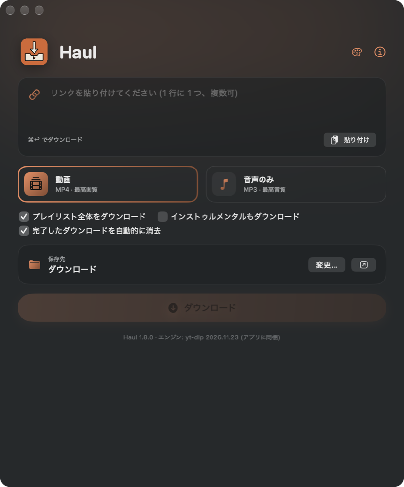
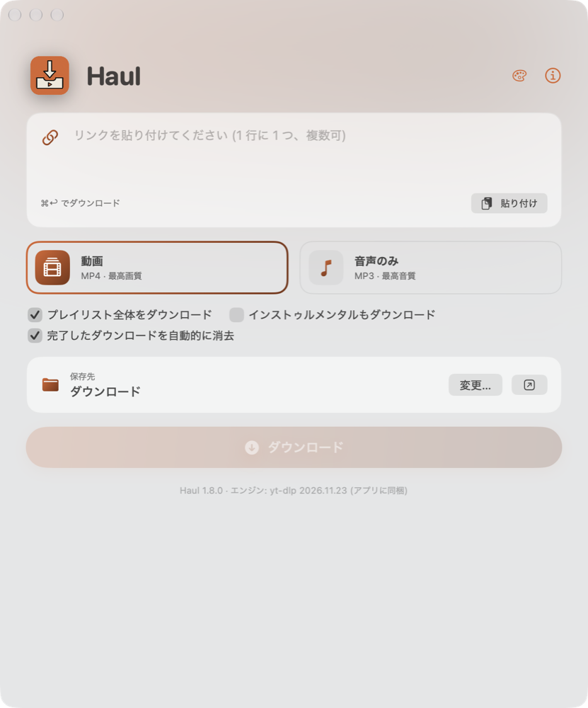

<p align="center"></p>

<h1 align="center">Haul</h1>
<p align="center"><b>Web の動画や音楽をフォルダーへ。実際の作業は yt-dlp が行います。</b></p>

<p align="center"></p>

Gabriel Castiglia · 2026年11月27日 · バージョン 1.8.0 · GPL-2.0-only · yt-dlp 2026.11.23 で作成・テスト

[English](README.md) · [Español](README.es.md) · 日本語

Windows 版: <https://github.com/Gabriel-Castiglia/haul-windows>

> **macOS 15 以降、Apple シリコン (arm64) 搭載の Mac 専用です。** Intel プロセッサ搭載の Mac 向けのビルドはありません。

PDF マニュアル: [`docs/Haul-manual-ja.pdf`](docs/Haul-manual-ja.pdf)

Haul は [yt-dlp](https://github.com/yt-dlp/yt-dlp) のフロントエンドとして動く macOS アプリです。アプリはコマンドを組み立て、進行状況を表示し、ダウンロードのキューを管理します。実際の作業は、検証済みの固定バージョンでアプリに同梱された yt-dlp と、Homebrew でインストールされる ffmpeg が行います。表示言語は英語、スペイン語、日本語で、言語メニューから選べます。最初の起動時は英語で始まり、選んだ言語を覚えます。ウィンドウはライト、ダーク、または macOS に合わせる設定から選べ、12 色のどれかで表示されます。

## 動作環境

- macOS 15 以降、Apple シリコン搭載の Mac。macOS 27 でテストしています。
- `/opt/homebrew` にインストールされた [Homebrew](https://brew.sh)。
- ソースからビルドする場合: Apple の Command Line Tools (`xcode-select --install`)。Xcode は不要です。

yt-dlp はアプリに同梱されています。Python、deno、ffmpeg はインストーラが入れるので、手作業でインストールするものはありません。

## インストール

### インストーラパッケージで

[最新リリース](https://github.com/Gabriel-Castiglia/haul/releases/latest) から `Haul-<バージョン>.pkg` をダウンロードして開きます。インストーラは Mac の言語に合わせて英語、スペイン語、日本語で表示されます。まず Homebrew がインストールされているか確認し、なければメッセージを出して止まります。次に、起動中の Haul があれば終了してから `/Applications` に `Haul.app` をインストールし、Homebrew で Python、deno、ffmpeg をインストールするか、すでにあれば更新します。初回はこの手順に数分かかることがあります。新しいパッケージをインストールすると、設定を保ったまま Haul が更新されます。

パッケージは Apple Developer ID で署名されていないため、初回は macOS が開くのを拒否します (「Apple は検証できませんでした…」)。システム設定 → プライバシーとセキュリティ を開き、`Haul-<バージョン>.pkg` についてのメッセージまでスクロールして「このまま開く」をクリックし、確認します。インストールされたアプリは普通に開きます。各リリースの `SHA256SUMS.txt` で、先にダウンロードを確認できます:

```
shasum -a 256 Haul-1.8.0.pkg
```

アンインストールするには、Haul を終了して `/Applications/Haul.app` をゴミ箱にドラッグします。Python、deno、ffmpeg はほかのプログラムが使っているかもしれないので残ります。削除するには `brew uninstall` を使います。

### ソースから

```
git clone https://github.com/Gabriel-Castiglia/haul.git
cd haul
scripts/instalar.sh
```

インストーラは次のことをします:

1. Homebrew で Python、deno、ffmpeg をインストールし、すでにあれば更新する。
2. アプリをビルドし、同梱の yt-dlp を公式のチェックサムと照合し、ローカルの署名 ID でアプリに署名する (「署名と権限」を参照)。
3. 起動中なら終了してから `/Applications/Haul.app` にコピーする。

もう一度実行すると、依存関係もアプリもすべて更新されます。`scripts/paquete.sh` は代わりに `build/` にインストーラパッケージを作ります。パッケージでインストールしたものは root の所有なので、`scripts/instalar.sh` は止まり、先に削除する方法を表示します。

## 使い方

1. 上のボックスに 1 つまたは複数のリンクを貼り付けます。リンクは 1 行に 1 つでも、ほかの場所からコピーした文章の中に混ざっていてもかまいません。アプリがリンクを取り出し、重複を除きます。クリップボードへのアクセスを許可していれば、アプリを開いたときにコピー済みのリンクを自動で拾います。
2. 形式を選びます: 動画 (MP4) または音声のみ (MP3)。
3. 保存先フォルダーを選びます。最初はダウンロードフォルダーで、その後は最後に選んだフォルダーと形式を覚えます。
4. ダウンロードまたは ⌘↩ を押します。ダウンロードが始まるとボックスは空になり、すでにキューにあるリンクはクリップボードから再び拾われません。

リンクはキューに入り、1 つずつダウンロードされます。キューの実行中にもリンクを追加できます。各行にはサムネイル、タイトル、割合、速度、残り時間が表示され、終わると Finder で表示するかファイルを開けます。失敗またはキャンセルしたダウンロードは、再試行するか削除できます。キャンセルしたダウンロードは、自分で作った途中のファイルを削除します。別の形式で以前ダウンロードした同じ動画など、もともとフォルダーにあったファイルには触れません。

どの行も一時停止ボタンで止め、再生ボタンで続けられます。その間、途中のファイルはディスクに残るので、止めたところから再開します。キューの上の「すべて一時停止」はキュー全体を止めます。実行中のダウンロードは止まり、「すべて再開」まで先頭で待ちます。失敗したダウンロードがあると「すべて再試行」が現れ、失敗したものをすべてやり直します。行はマウスでドラッグして順番を変えられ、ダウンロードは一覧の順に始まります。

失敗したダウンロードは 2 秒おきに最大 4 回まで再試行され、行には何回目かが表示されます (「再試行 2/4」)。途中のファイルは試行の間も残るので、yt-dlp は止まったところから再開します。ダウンロードが終わると、ファイル同期クライアントが開いていたせいで yt-dlp が消せなかった MP3 の元の音声など、中間ファイルもアプリが削除します。

形式の下にある「完了したダウンロードを自動的に消去」チェックボックスは、キューが空でも常に表示されています。チェックしている間は、終わったダウンロードやキャンセルしたダウンロードが自動で一覧から消え、集計には数えられたまま残ります。失敗したものは再試行できるよう残ります。チェックすると、すでに終わっていたものも消えます。この設定は保存されます。

タイトルに「instrumental」が入った動画は、「インストゥルメンタルもダウンロード」をチェックしない限り、キューで一時停止したまま待ちます。一時停止中の行はそのダウンロードボタンで個別にダウンロードでき、このオプションをチェックするとすべて再開します。

ウィンドウの ⓘ ボタン、またはメニューバーの Haul > Haul について で、バージョン、名前の意味、作者、ライセンス、このリポジトリへのリンクが表示言語で表示されます。ヘッダーからダウンロードボタンまでは固定で、スクロールするのはキューだけなので、リンクを追加してもウィンドウは動きません。

ターミナルやショートカットから、リンクを付けてアプリを起動することもできます:

```
open -a Haul --args --descargar URL1 URL2
```

## 形式

| 形式 | 結果 | yt-dlp のオプション |
|---|---|---|
| 動画 | H.264 と AAC の MP4。H.264 で利用できる最高解像度 | `-f bv*+ba/b -S vcodec:h264,res,acodec:aac --merge-output-format mp4` |
| 音声のみ | 最高音質の MP3 | `-x --audio-format mp3 --audio-quality 0` |

QuickTime と iOS が変換なしで再生できるので、H.264 を優先します。ファイル名は動画のタイトルになります。

## プレイリスト

プレイリストのリンクやチャンネルのページは、まず何もダウンロードせずに読み込まれ、各動画がサムネイルと位置 (「Mix · 3/12」) 付きでキューの 1 行になります。ファイルはプレイリスト名のサブフォルダーに入り、プレイリストの順に番号が付きます: `01 - タイトル.mp4`、`02 - タイトル.mp4` のように。各動画は個別にキャンセルや再試行ができます。200 本を超えるプレイリストは、先に確認を求めます。

プレイリストから開いた動画のリンクは、「プレイリスト全体をダウンロード」がチェックされている間 (既定ではチェック済み)、プレイリスト全体を取り込みます。チェックを外すと、ウィンドウのカードがそのたびに、その動画だけかプレイリスト全体かを尋ねます。この設定は保存されます。ほかのリンクはそのまま、1 本ずつダウンロードされます。

複数の投稿をまとめ、それぞれに埋め込み動画があるタグのページも同じように読み込まれます。投稿ごとに 1 行、古いものから新しいものへ並ぶので、シリーズはエピソードの順を保ちます。

## リポジトリの構成

| パス | 内容 |
|---|---|
| `fuentes/Haul.swift` | アプリのソースコード (SwiftUI) |
| `assets/icon.svg` | アイコンの原画 (作者のアイコンツールで 12 色に描き出します。Windows 版と共通) |
| `icono/icono-1024.png` | 既定のオレンジのアプリアイコン。各サイズの元 |
| `icono/accents/` | Dock 用の、各色のアイコン |
| `docs/images/` | ウィンドウの画像 |
| `scripts/instalar.sh` | 依存関係、ビルド、インストール |
| `scripts/compilar.sh` | `build/` へのビルドと署名 |
| `scripts/paquete.sh` | インストーラパッケージ `build/Haul-<バージョン>.pkg` を作る |
| `instalador/` | パッケージの定義: `Distribution.xml`、Haul を終了し Homebrew のパッケージを入れるスクリプト、英語・スペイン語・日本語のページ |
| `scripts/firma.sh` | ローカルの署名 ID (`compilar.sh` から読み込まれます) |
| `scripts/manual.sh` | README から PDF マニュアルを作る |
| `scripts/actualizar-yt-dlp.sh` | 同梱の yt-dlp を、検証済みの別のリリースに置き換える |
| `plugins/haul/` | 同梱のバージョンが扱えないリンクのための、Haul 独自の yt-dlp 抽出プラグイン |
| `vendor/yt-dlp/` | 同梱の yt-dlp 2026.11.23。ソース、チェックサム、署名、ライセンス付き |
| `docs/Haul-manual-en.pdf`、`docs/Haul-manual-es.pdf`、`docs/Haul-manual-ja.pdf` | 英語、スペイン語、日本語の PDF マニュアル |
| `docs/manual.css` | マニュアルのスタイルシート |
| `README.md`、`README.es.md`、`README.ja.md` | このドキュメント (英語、スペイン語、日本語) |
| `CHANGELOG.md` | 変更履歴 |

`build/` フォルダーはビルド時に作られ、リポジトリには含まれません。

## 署名と権限

macOS は、ダウンロードフォルダーやクリップボードへのアクセスなど、ユーザーが許可した権限をアプリの署名と結び付けて保存します。アドホック署名はビルドのたびに変わるため、macOS はまた許可を求めます。そのためこのプロジェクトは独自の安定した証明書「Haul (local signing)」で署名します。`scripts/firma.sh` が、アプリをビルドする Mac で初回に作ります:

- 証明書とその鍵は専用のキーチェーン `~/Library/Keychains/haul-signing.keychain-db` にあります。
- そのキーチェーンのパスワードは、ログインキーチェーンに `haul-local-signing` という名前で保存されます。

この署名なら、一度許可した権限はバージョンをまたいで保たれます。証明書は作った Mac にしかありません。インストーラパッケージの中のアプリは、リリースをビルドした Mac の署名を持ち、どのリリースでも同じなので、パッケージでインストールした更新でも権限は保たれます。

アプリを開いたときのリンクの自動貼り付けは、クリップボードへのアクセスが「常に許可」になっている場合だけ動きます (システム設定、プライバシーとセキュリティ、ほかのアプリからのペースト)。この許可がなければ、アプリは「貼り付け」を押したときだけクリップボードを読み、開いたときに確認も出しません。

## 外観とアイコン

外観メニュー (ウィンドウのパレットボタンからも開けます) で、ライト、ダーク、macOS に合わせるのいずれかと、12 色のうち 1 色を選びます。選んだ色はボタン、チェックボックス、選択中の項目と、Haul を開いている間の Dock のアイコンに使われます: アイコンの下地がその色になります。Finder と Launchpad のアイコンはオレンジのままです。変えるとアプリの署名が壊れるためです。すでに起動したことのある Haul は以前のダークのウィンドウのまま、新しくインストールした Haul は macOS に合わせます。



アイコン (トレイに入るダウンロードの矢印) は Haul のために描いたもの (2026 年) で、ほかと同じく GPL-2.0 です。原画は `assets/icon.svg` で、`icono/` に各色のものがあります。変更したら `scripts/instalar.sh` でアプリを入れ直します。Dock に古いアイコンが残る場合は、Haul を終了して Dock のアイコンキャッシュを空にします:
`rm "$(getconf DARWIN_USER_CACHE_DIR)com.apple.dock.iconcache"; killall Dock`。

## 新しいバージョン

Haul は 1 日 1 回 GitHub に最新リリースを問い合わせます。Haul について の「アップデートを確認」も同じです。新しければ、質問は 1 回だけです: 今すぐアップデート、新機能を見る、後で。今すぐアップデート を選ぶと、パッケージをダウンロードしてリリースの `SHA256SUMS.txt` と照合し (一致しないファイルは開かずに削除します)、中のアプリが同じ識別子、バージョン、署名を持つか確かめます。実行中のダウンロードがあればどうするか (今すぐ更新するか、キューが終わってからか) を尋ね、キューを保存して終了し、新しいアプリを古いものと入れ替えて開きます。`/Applications/Haul.app` ではないコピーにはダウンロードページを、別のユーザーがインストールしたものには確認済みのパッケージをインストーラで開きます。問い合わせで送るのはプログラム名とそのバージョンだけです。毎日の確認は Haul について でオフにできます。

## セッションをまたぐキュー

キューは Haul を終了しても残ります: 待機中、一時停止中、失敗した行と、まだ待っているリンクが同じ順に戻ります。実行中だったダウンロードは待機中として戻り、途中のファイルから再開します。終了すると yt-dlp も止まるので、Haul なしでダウンロードが続くことはありません。キューは `~/Library/Application Support/Haul/queue.json` に、一時ファイルを通して書き込まれます。壊れたファイルは `queue.damaged.json` として退避され、Haul は空のキューで起動します。

## yt-dlp の更新

1 日 1 回 (Haul について でオフにできます) と「yt-dlp を更新」で、Haul は yt-dlp の最新の公式リリースを `~/Library/Application Support/Haul/yt-dlp/<バージョン>` に取得し、`SHA2-256SUMS` と自身のバージョン番号で確認してから、次のダウンロードで使います。実行中のダウンロードは、始めたときのコピーを使い続けます。アプリ内のコピーはそのまま残り、確認済みの新しいコピーがなければ再び使われます。古いコピーは Haul の起動時に削除されます。

## メンテナンス

Haul は yt-dlp 2026.11.23 でビルド・テストされており、まさにそのコピーがアプリに同梱されています (上のとおり、新しいコピーはアプリ自身が取得することもあります)。バージョンを固定すると動作が安定し、yt-dlp のリポジトリが公開され続けることにも依存しません。その代わり、サイトは頻繁に変わるので、固定したバージョンはいずれ動かなくなります。そうなったら、Haul の新しいリリースで新しい yt-dlp に移ります:

```
scripts/actualizar-yt-dlp.sh <バージョン>
scripts/instalar.sh
```

最初のスクリプトはリリースをダウンロードし、`vendor/yt-dlp/public.key` の鍵で署名を、SHA-256 チェックサムでファイルを検証してから、はじめてファイルを置き換えます。`scripts/instalar.sh` をもう一度実行すると、Python、deno、ffmpeg も更新されます。

よくある yt-dlp のエラー (動画が利用できない、非公開の動画、対応していないサイト、接続なし) は、表示言語のわかりやすい言葉で表示されます。それ以外は yt-dlp が出力したとおりに表示されます。

設定 (言語、フォルダー、形式、ウィンドウの大きさ、「完了したダウンロードを自動的に消去」と「インストゥルメンタルもダウンロード」) は `io.github.gabriel-castiglia.haul` ドメインに保存されます。`defaults delete io.github.gabriel-castiglia.haul` で初期化できます。

## 技術的な注意

アプリは同梱の yt-dlp を Homebrew の Python で子プロセスとして実行し、`PATH` に `/opt/homebrew/bin` を加えます。Finder から起動したアプリはターミナルの `PATH` を引き継がず、deno や ffmpeg を見つけられないためです。yt-dlp がターミナル向けに出す文章に依存しないよう、タブ区切りの独自形式で出力させます:

| 行 | 内容 | 出どころ |
|---|---|---|
| `META` | ID、チャンネル、投稿者、タイトル、サムネイル。ダウンロード前に確認 | `-O pre_process:…` |
| `INFO` | タイトル、投稿者、長さ、サムネイル、ファイル名 | `-O before_dl:…` |
| `AVANCE` | 割合、速度、残り時間 | `--progress-template` |
| `ARCHIVO` | 最終的なファイルのパス | `-O after_move:…` |

一時停止中のインストゥルメンタルは `--match-filters` で止めるので、許可されるまで yt-dlp は何もダウンロードしません。

yt-dlp は常に `--ignore-config` 付きで実行され、設定ファイルを読みません (ダウンロードフォルダーに置かれた `yt-dlp.conf` が、`--exec` などのオプションを加えられないようにするためです)。プラグインは Haul 独自のものだけを読み込みます (`--no-plugin-dirs` のあとに Haul の `plugins` フォルダーを `--plugin-dirs` で指定)。そのため、ユーザー自身の yt-dlp の設定ファイルも適用されません。サムネイルは `http` と `https` のアドレスからだけ表示します。

最新リリースを含め、yt-dlp そのものの中で失敗するリンクがあります: 埋め込みプレーヤーは不要なのに、今はアカウントを求める動画ページや、データが別の場所に移ったページです。Haul は `plugins/haul/` に独自の yt-dlp 抽出プラグインを持ち、`Contents/Resources/plugins` にコピーして使います。プラグインの抽出器は組み込みのものより先に試され、それぞれ自分が直すリンクにだけ一致します。埋め込みプレーヤーがときどき 401 エラーを返すときは、プラグインが最大 3 回再試行します。Python は `PYTHONDONTWRITEBYTECODE=1` で実行し、署名されたアプリの中に `__pycache__` を書かないようにしています。

Xcode なしでビルドすると制約が 2 つあり、どちらもコードで対処しています。1 つ目に、SwiftUI の `@State` マクロが使えません。そのプラグインは Xcode にしか含まれないためで、代わりに `Marca` クラスと `@StateObject` を使っています。2 つ目に、タイトルバーを隠すと SwiftUI は `.defaultSize` を無視するので、ウィンドウの初期サイズは `applicationDidFinishLaunching` で AppKit から設定しています。

## クレジット

Haul はフロントエンドです。大変な仕事は次のプロジェクトが担っています:

| プロジェクト | Haul での役割 | ライセンス |
|---|---|---|
| [yt-dlp](https://github.com/yt-dlp/yt-dlp)、yt-dlp の貢献者による、youtube-dl のフォーク | ダウンロードエンジン。`vendor/yt-dlp` に同梱 | [Unlicense](https://github.com/yt-dlp/yt-dlp/blob/master/LICENSE) |
| [yt-dlp-ejs](https://github.com/yt-dlp/ejs)、yt-dlp の実行ファイルに含まれる | JavaScript のチャレンジを解く | Unlicense |
| [meriyah](https://github.com/meriyah/meriyah)、KFlash ほか、yt-dlp-ejs に含まれる | JavaScript パーサー | [ISC](https://github.com/meriyah/meriyah/blob/main/LICENSE.md) |
| [astring](https://github.com/davidbonnet/astring)、David Bonnet、yt-dlp-ejs に含まれる | JavaScript コードジェネレーター | [MIT](https://github.com/davidbonnet/astring/blob/main/LICENSE) |
| [FFmpeg](https://ffmpeg.org)、Homebrew でインストール、同梱なし | 映像と音声の結合、MP3 への変換 | [LGPL-2.1+ / GPL-2.0+](https://ffmpeg.org/legal.html) (ビルドによる) |
| [Deno](https://deno.com)、Homebrew でインストール | yt-dlp が使う JavaScript ランタイム | [MIT](https://github.com/denoland/deno/blob/main/LICENSE.md) |
| [Python](https://www.python.org)、Homebrew でインストール | yt-dlp を実行する | [PSF License](https://docs.python.org/3/license.html) |
| [Homebrew](https://brew.sh) | 依存関係をインストールする | [BSD-2-Clause](https://github.com/Homebrew/brew/blob/master/LICENSE.txt) |
| [pandoc](https://pandoc.org)、PDF マニュアルの作成時のみ | Markdown から HTML への変換 | [GPL-2.0+](https://github.com/jgm/pandoc/blob/main/COPYRIGHT) |

同梱コンポーネントのライセンス文は `vendor/yt-dlp/licenses/` にあり、アプリの `Contents/Resources/licenses/` にもコピーされます。

## ライセンス

Copyright (C) 2026 Gabriel Castiglia.

Haul はフリーソフトウェアで、Linux カーネルと同じ GNU General Public License バージョン 2 (GPL-2.0-only) で公開しています。使用、研究、改変、再配布ができます。改変版を配布する場合は、同じライセンスで、ソースコードとともに公開しなければなりません。全文は [`LICENSE`](LICENSE) にあります。

Haul は `vendor/yt-dlp` に yt-dlp の無改変のコピーを含みます。yt-dlp は独自のライセンス (Unlicense、ISC と MIT のコンポーネントを含む) のままで、GPL の対象ではありません。Haul は yt-dlp と ffmpeg を別のプログラムとして実行し、リンクはしません。ffmpeg は同梱していません。
